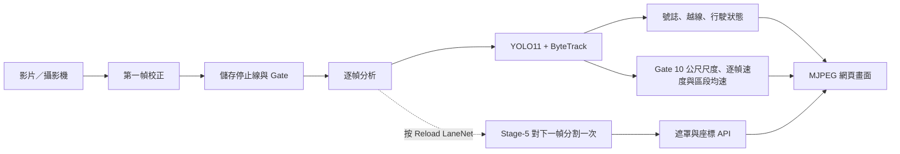

# 交通影像監測系統

本專案是學校專題比賽作品，目標是讓交通影像的違規偵測、車流觀察與場景校正更容易設定，也更容易依使用情境調整。現階段以團隊自行錄製的實際道路影片回測功能；長期目標是讓手機或其他有鏡頭的裝置將即時影像送到雲端伺服器，讓使用者在同一處查看不同地點的交通狀況。

目前主程式以影片、攝影機或 OpenCV 可讀取的影像串流為輸入，分析車輛、交通號誌、停止線越線事件及道路標線。操作員在瀏覽器的第一幀畫面完成校正後，FastAPI 背景工作會逐幀處理影像，並以 MJPEG 串流顯示標註結果。

> **目前功能範圍：** 車輛接地點尚未進入停止線與最後一個 Gate 之間時不顯示速度；位於區間內才顯示黃色逐幀 `EST` 讀數，軌跡尚不足時加上 `(estimate)` 或暫顯示 `EST -- km/h (estimate)`。車輛從停止線或最後一個 Gate 任一端離開區間後，黃色讀數消失，只顯示紅字 `SECTION` 區段測速；不足兩個連續 Gate 穿越點時顯示 `SECTION -- km/h`。兩端使用相同幾何狀態判斷，因此可處理畫面中的雙向車流。正式串流以操作員標示的**相鄰一般 Gate 10 公尺**作為公尺尺度；選配的 `Gate X.4` 將該週期分成 4 公尺與 6 公尺。這是場景設定的距離假設，若實地標線間距不同，時速會有比例誤差。所有數值仍未經真實車速比對，不可視為精確或執法測速。`ILLEGAL` 是依程式的號誌與越線規則產生的提示，應由人員複核。

## 背景、目標與應用

團隊關注臺灣道路車流混雜、路口衝突及人工監看的時間與範圍限制，希望透過影像辨識及可調整的規則，及早發現高風險行為、提高監看效率，並累積可供交通管理參考的車流資訊。系統定位為民間可使用的輔助工具，期望未來與公路局等主管機關合作，比對雙方資料；目前尚未接入公部門資料，也不將模型輸出視為正式裁罰依據。

預想情境包含一般民眾觀察自家車庫前的交通、社區出入口管理，以及政府部門在路口進行初步事件篩查。專題規劃的議題是闖紅燈、違規變道、車流量，以及利用車道標線作為測速基準；各功能的實作狀態如下。

| 功能 | 現階段狀態 |
| --- | --- |
| 紅燈越線提示 | 已依單一號誌顏色與停止線跨越事件實作；仍需人工確認。 |
| 車流量觀察 | 已顯示 `IN`／`OUT` 越線計數與本次處理摘要，尚未提供長期統計。 |
| 車輛行駛／停止狀態 | 已依影像位移分類；不是實際車速。 |
| 道路標線辨識 | 按 Reload LaneNet 後以 Stage-5 對下一幀分割一次，快取遮罩及座標供後續畫面使用。 |
| 違規變道判定 | 規劃以跨越實線、變道時未打方向燈為候選條件；尚未實作事件判定。 |
| 畫面預估測速 | Gate／停止線／邊界提供局部道路幾何；相鄰一般 Gate 固定按 10 公尺換算。車輛位於停止線與末 Gate 之間時以黃字顯示逐幀速度，從任一端離開後只以紅字顯示完整 Gate 區段均速；雙向共用此規則。狀態列提示距離是假設值；尚未與真實車速驗證。 |
| 雲端多鏡頭監看 | 長期目標；目前為單一來源的本機 FastAPI 服務。 |

## 使用流程



1. **準備來源。** 未指定時，程式讀取 `python/main.py` 中 `DEFAULT_VIDEO_NAME` 指定的 `inputVideos/` 影片；也可用 `--source` 指定影片／串流，或用 `--camera` 選擇實體、虛擬攝影機。
2. **校正畫面。** 伺服器先顯示第一幀，此時不執行 YOLO。於網頁上點兩下設定停止線端點、逐點標出道路左右邊界並按 Enter 完成，再點選虛線頂端建立至少五條一般 Gate，並設定整條路的車道數。
3. **啟動判斷。** 點選「開始判斷」後，網頁先呼叫 `/save_points` 寫入校正檔，再呼叫 `/start_processing` 啟動背景工作。影片會從指定的起始影格重新讀取。
4. **查看結果。** 網頁顯示車輛 ID、偵測框、`MOVING`／`STOPPED` 狀態、號誌顏色及 `IN`／`OUT` 越線計數。車輛進入停止線與最後一個 Gate 之間後，黃色逐幀速度先顯示 `EST -- km/h (estimate)`，有兩次有效位置後開始顯示數值；至少有四個接地點、軌跡跨越 0.12 秒且速度可與座標抖動區分時移除 `(estimate)`，顯示 0 km/h 則至少觀察 0.4 秒。車輛尚未進入時不顯示速度；從停止線或最後一個 Gate 任一端離開後，只以紅字顯示已完成的連續 Gate 區段均速與起訖 Gate，沒有完整 Gate 對時顯示 `SECTION -- km/h`。下方狀態列會顯示後端實際選定的 YOLO 裝置，以及 Stage-5 在 Reload 時使用的裝置，並提示相鄰一般 Gate 按 10 公尺換算、尚未現地量距。開始判斷後按「Reload LaneNet」才會偵測道路標線並顯示快取結果，座標可由 API 讀取；終端機在處理結束時輸出本次統計。
5. **重新處理或結束。**「重新判斷」會中止目前工作並以網頁上的校正重新開始；「關閉系統」會停止服務。目前只持久儲存校正資料，沒有匯出標註影片、逐筆事件或統計報表。

系統將「物件偵測與追蹤」及「逐像素標線分割」分為兩條處理路徑：前者保留同一車輛的時間資訊，後者提供道路幾何形狀。停止線與 Gate 由人員在當前場景校正，以適應不同鏡頭位置；正規化座標讓網頁縮放時仍能對應回原始影像。多幀投票、越線防抖區與移動狀態遲滯門檻用來降低單幀偵測抖動造成的反覆切換。

## 安裝與執行

本專題固定使用 **Python 3.12.x**，每次執行都須明確指定此版本。另需 `requirements.txt` 中的套件、可讀取的影像來源及模型權重。PyTorch／TorchVision 的安裝方式可能因作業系統與 CUDA 版本而異。

macOS：

```bash
python3.12 --version
python3.12 -m pip install -r requirements.txt
python3.12 python/main.py --source /path/to/video.mp4
```

Windows PowerShell：

```powershell
py -3.12 --version
py -3.12 -m pip install -r requirements.txt
py -3.12 python\main.py --source C:\path\to\video.mp4
```

啟動後開啟 <http://127.0.0.1:8000>。若要使用預設來源，先將 `DEFAULT_VIDEO_NAME` 指定的影片放進 `inputVideos/`，再省略 `--source`。專題會依測試需求使用 YOLO11s 或 YOLO11x；目前程式預設 `yolo11x.pt`，第一次使用該官方模型名稱時，Ultralytics 會嘗試下載。要改用 11s 或其他權重，先備妥本機 `.pt` 檔，再以 `--model` 指定。道路標線模型預設讀取團隊自行訓練的 `models/road_marking/stage5_roadmark_best.pth`；缺少該模型時可用 `--no-road-markings`。

常用選項（macOS；Windows 將 `python3.12` 改為 `py -3.12`，並依系統調整路徑）：

```bash
# 指定裝置及自訂 YOLO 權重
python3.12 python/main.py --source /path/to/video.mp4 --device cpu --model /path/to/model.pt

# 使用攝影機或 OBS Virtual Camera；索引依電腦而異
python3.12 python/main.py --camera 1 --camera-width 1280 --camera-height 720 --camera-fps 30
python3.12 python/main.py --list-cameras --camera-backend auto

# 調整 Reload LaneNet 時的道路標線推論解析度，或停用道路標線
python3.12 python/main.py --road-marking-max-side 960
python3.12 python/main.py --no-road-markings
```

`--device auto` 依序選擇 CUDA、MPS、CPU；明確指定 CUDA 或 MPS 但當前不可用時會改用 CPU。YOLO 輸入長邊目前於 MPS 使用 640，CUDA／CPU 使用 512；道路標線模型預設使用長邊 1280。Stage-5 在 YOLO 使用 MPS 時改用 CPU，使用 CUDA 時仍用 CUDA。開始判斷後，網頁狀態列會顯示例如 `裝置：YOLO MPS｜Stage-5 CPU（Reload 時）` 的實際選擇；停用道路標線時會顯示 Stage-5 停用。Windows 攝影機無法讀取時可嘗試 `--camera-backend dshow` 或 `msmf`。其餘選項請在 macOS 執行 `python3.12 python/main.py --help`，或在 Windows 執行 `py -3.12 python\main.py --help`。

Gate 尺度、速度顯示區間與推論裝置狀態已在 macOS 使用 Python 3.12 執行 `python3.12 -m unittest discover -s tests -v`（67 項通過，含 10 公尺正規化、Gate 交界平滑、加減速與低 FPS 反應、停止線至末 Gate 的雙向進出狀態、黃字與紅字切換、實際裝置 API、`TEMP`／正式 ID 交接及追蹤中斷測試）與 `python3.12 -m compileall -q python`。前端幾何與 JSON 流程先前以 JavaScriptCore 模擬測試通過，`start.command` 先前通過 zsh 語法及 `./start.command --help` 檢查。`inputVideos/newVid.mov` 已可讀取，已用保存的四段 Gate 幾何做合成軌跡檢查；本機目前沒有相容的 YOLO COCO 權重，尚未完成該影片的端到端預估速度、真實速度對照、完整 MJPEG 畫面或 Windows 實測。

`start.command` 與 `start.bat` 現在會確認 Python 3.12.x 並直接呼叫該版本，不搜尋其他執行環境；macOS 腳本遇到已占用的埠號會報錯，不會強制結束其他服務。`start-virtual-camera.bat` 使用 `--device auto`，有 CUDA 時會選 CUDA，否則走 CPU。腳本仍需在各自系統以實際影片或攝影機完成啟動驗證；若要使用 Windows 的 OBS Virtual Camera，先啟動它，再執行 `start-virtual-camera.bat` 或明確指定 `py -3.12 python\main.py --camera 1 --camera-width 1280 --camera-height 720 --camera-fps 30 --device auto`。若只想驗證道路標線模型，macOS 可執行 `python3.12 python/road_marking_demo.py /path/to/image.jpg`，產生單張影像的疊圖與 JSON 座標。

## 停止線與 Gate 校正

在第一幀畫面先點一下**停止線**的 **L** 錨點，移動滑鼠可即時預覽線段，再點一下設定 **R**；停止線應跨越所有要校正的車道。接著從停止線 L 端沿道路逐點點擊左邊界，移動滑鼠時會預覽目前點到滑鼠位置的線段，按 **Enter** 完成；再從 R 端逐點點擊右邊界並按 Enter 完成。邊界可用多點貼合彎道，也可按畫面上的完成按鈕。畫面中的校正線段寬度為 1 px。設定整條路的預設車道數後，逐次點選白色虛線頂端建立 Gate；點選 Gate 清單項目，再拖曳與錨點分開的圓形把手調整角度。前端將經過錨點的直線與兩側邊界求交，交點就是有限 Gate 的兩端。Gate 無法與兩側邊界相交時會顯示警示，不能開始判斷。工具列可暫停繪製、復原、重做及更換 Gate 顏色。

道路車道數固定時，調整「預設車道數」會套用至所有 Gate；它不能單獨推算遠處的畫面寬度，因此仍須標出道路邊界。停止線提供邊界起點與 Gate 初始角度，之後每條 Gate 可自行調整。這只是影像上的人工幾何校正，並未保證 Gate 在真實道路平面與車道方向成 90 度。

前端至少需要五條一般 Gate；在一般 Gate 後可選擇下一條為 `Gate X.4`，表示同週期內的選配位置。前端以 `Gate 1 = 0`、`Gate 1.4 = 4`、`Gate 2 = 10` 填入 `station_m`；後端按 Gate 名稱重新換算並儲存，一般 Gate 每段 10 公尺，選配 Gate 拆成 4／6 公尺。這些公尺數是操作員採用的**現地距離假設**。`lane` 代表車道數而非車道編號。按「開始判斷」時，前端把 Gate 換算成正規化 L/R 線段，連同錨點、角度與道路邊界傳給 `/save_points`；後端寫入 `cord_data/points_data.json` 的版本 3 格式，例如：

停止線兩端的順序會影響跨線側別與 `IN`／`OUT` 的方向；不同影片可在 `python/main.py` 的 `VIDEO_CONFIGS` 設定 `in_transition`。未列入的來源預設以上側到下側為 `IN`，校正時應依畫面中的行進方向確認。

```json
{
  "schema_version": 3,
  "video": {"name": "example.mp4", "coordinate_system": "normalized_0_to_1", "width": 1000, "height": 650},
  "lane_count": 2,
  "stop_line": {"line": {"L": {"x": 0.15, "y": 0.60}, "R": {"x": 0.85, "y": 0.60}}},
  "road_boundaries": {
    "L": [{"x": 0.15, "y": 0.60}, {"x": 0.25, "y": 0.10}],
    "R": [{"x": 0.85, "y": 0.60}, {"x": 0.75, "y": 0.10}]
  },
  "gates": [
    {"gate": "Gate 1", "lane": 2, "station_m": 0, "anchor": {"x": 0.50, "y": 0.55}, "angle_deg": 0, "line": {"L": {"x": 0.16, "y": 0.55}, "R": {"x": 0.84, "y": 0.55}}},
    {"gate": "Gate 2", "lane": 2, "station_m": 10, "anchor": {"x": 0.50, "y": 0.45}, "angle_deg": 0, "line": {"L": {"x": 0.18, "y": 0.45}, "R": {"x": 0.82, "y": 0.45}}},
    {"gate": "Gate 3", "lane": 2, "station_m": 20, "anchor": {"x": 0.50, "y": 0.35}, "angle_deg": 0, "line": {"L": {"x": 0.20, "y": 0.35}, "R": {"x": 0.80, "y": 0.35}}},
    {"gate": "Gate 4", "lane": 2, "station_m": 30, "anchor": {"x": 0.50, "y": 0.25}, "angle_deg": 0, "line": {"L": {"x": 0.22, "y": 0.25}, "R": {"x": 0.78, "y": 0.25}}},
    {"gate": "Gate 5", "lane": 2, "station_m": 40, "anchor": {"x": 0.50, "y": 0.15}, "angle_deg": 0, "line": {"L": {"x": 0.24, "y": 0.15}, "R": {"x": 0.76, "y": 0.15}}}
  ]
}
```

後端驗證至少三條 Gate、非零線段、`lane ≥ 1`、座標介於 0～1、`station_m` 遞增，及從 `Gate 1` 起連續編號；選配的 `Gate X.4` 必須緊接 `Gate X`。前端另要求五條一般 Gate。該 JSON 屬執行時校正資料，請勿將不同影像來源的座標直接共用。

「匯出校正 JSON」會另外下載**版本 3** 的 `gate_geometry.json`，儲存停止線、原始影像尺寸、車道數、左右邊界，以及各 Gate 的錨點、影像像素角度與 `station_m`；Gate 的 L/R 由前端重新計算，不存於此匯出檔。可用「匯入校正 JSON」載回同尺寸影片的校正，也可手動匯入新版 `points_data.json`；仍須人工確認是同一個場景。後端儲存檔同時保留計算出的 L/R，供目前的越線與測速流程使用。網頁不會自動回填既有 Gate。

## 技術原理

### 車輛與交通號誌

YOLO11 偵測 COCO 類別中的汽車、機車、公車、卡車與交通號誌，Ultralytics 的 ByteTrack 為車輛維持追蹤 ID。程式從號誌框中選出「信心分數 × 面積」最高者，將其 ROI 轉為 HSV 色彩空間，以紅、綠像素比例判斷顏色，再以近期有效結果投票取得穩定狀態。號誌辨識不依賴車輛追蹤 ID；該幀只有號誌偵測、沒有追蹤 ID 時仍會更新狀態。無法辨識的一幀不會立即清除前一個狀態。目前沒有黃燈判斷，也沒有將號誌分別對應到不同車道。

### 越線事件與行駛狀態

程式以車輛**接地位置**作為軌跡點：若 YOLO 權重提供實例遮罩，取遮罩靠近車框底部的輪廓點；一般偵測權重則退回框的底部中心。用向量叉積判定其位於停止線哪一側。接地點移動線段確實與**有限的停止線**相交、且跨過 12 像素防抖區時，依方向記為 `IN` 或 `OUT`；垂直與傾斜停止線使用同一幾何判定。同一追蹤狀態下，每個方向只計一次。若當下穩定號誌為 `RED`，車輛被標記為 `ILLEGAL`。目前兩個越線方向都可能觸發紅燈標記。ByteTrack 暫時沒有 ID 的車框會用短期位置關聯供測速，但不參與越線違規與正式車流計數。

行駛狀態先以背景特徵點光流及 RANSAC 估計相鄰影格的局部仿射變換，再扣除攝影機移動對車輛位置的影響，對剩餘的每影格位移做指數平滑。低於 0.5 像素／影格或高於 1.5 像素／影格連續五幀，分別判定 `STOPPED` 或 `MOVING`。這是影像位移分類，**不是實際道路速度**。

### 道路標線

開始判斷後按 **Reload LaneNet**，Stage-5 SegFormer 才會載入並對當前影格進行一次逐像素語意分割；模型隨後釋放，偵測結果在後續影格持續疊圖，直到下一次 Reload。未按 Reload 時不執行 Stage-5 推論；重新判斷會等待上一輪工作執行緒完全結束，並沿用本次服務記憶體中的標線，服務重啟則需重新偵測。標線疊圖的類別色彩遮罩與折線像素座標也會隨結果快取，避免每幀重建。合成 1280×720 影像、20 次繪製的本機測試中，每幀約由 7.5 ms 降至 4.6 ms；這不是完整 YOLO 處理速度。目前輸出 RLMD 類別 1～10、16，包括槽化區、斑馬線、停止線、實線、虛線及導流線。程式透過連通元件擷取輪廓、中心、外接框及中心線；線類擬合為折線。虛線的 `components` 保留各小段，`polylines` 則將可能屬於同一車道的小段串接。API 同時提供原圖像素 `x/y` 與正規化座標 `nx/ny`；`lane_id` 是單次結果內的折線序號，不是跨影格追蹤 ID。

### 違規變道構想（尚未實作）

團隊規劃以道路標線分割辨認實線邊界，再將車輛追蹤軌跡與邊界對照，判定是否跨越實線；另一個候選條件是變道時未打方向燈。後續仍須實作車輛與車道的關聯、方向燈的時序辨識，以及跨線前後的判定時間窗。現有程式只提供標線座標和車輛追蹤資料，尚未將兩者結合成變道事件。

### 僅用影片的預估時速

前端停止線、左右邊界與 Gate 定義影像中的道路形狀。`python/gate_speed.py` 以每對 Gate 四端點建立局部透視映射；停止線可延伸第一／末段，邊界用於彎道車道曲線。正式串流將相鄰一般 Gate 設為 10 公尺，選配的 `Gate X.4` 設為從 `Gate X` 起 4 公尺，因此下一條一般 Gate 距它 6 公尺；後端依名稱重新計算 `station_m`，不受舊 JSON 中其他數值影響。**如果實際標線間距不是這些數值，估速就會按距離比例偏移。** 僅靠影像幾何與時間無法驗證這個絕對距離；這裡明確採用操作員提供的距離假設。

每台車的接地點投影至局部道路平面後，程式在停止線與最後一個 Gate 之間用最近約 0.5～1 秒的軌跡估計速度：遠處透視敏感時保留較長資料，近處縮短視窗以減少加減速延遲；低 FPS 時最多延長到 3.1 秒，盡量保留四個有效位置，因此反應較慢。相鄰 Gate 的局部透視映射在共同 Gate 附近平滑混合，減少跨段時的速度跳躍。程式同時試算 ±2 像素接地點位移，並從軌跡殘差估計實際抖動；位移不足以區分時暫以 0 km/h 處理。逐車濾波依映射敏感度調整響應，並限制單幀速度變化；完成的連續 Gate 區段均速只在透視敏感處限制短時間偏高的逐幀讀數，避免壓低近處真實加速。這些處理會帶來一定延遲，且不能還原畫面中缺失的實際距離資訊。早期讀數保留「(estimate)」；至少四個位置、0.12 秒且讀數可分辨時移除，顯示 0 km/h 則至少觀察 0.4 秒。道路邊界可近似修正彎道內外車道的路徑差；沒有可用邊界時採用 Gate 已知距離，不猜測內外車道差。影片優先使用單調遞增的來源時間戳，不可用時用影格序號／FPS；攝影機使用單調時鐘。ByteTrack 暫無 ID 的 `TEMP` 車也用短期軌跡估速；`TEMP` 與正式 ID 在相鄰兩幀的車框充分重疊時轉移測速與區間狀態，避免 ID 閃爍使讀數重新開始。位置匹配不明確時不強行轉移。

停止線與最後一個 Gate 的兩條無限延伸線形成速度顯示區間；程式用各自朝向另一條邊界的半平面判定接地點是否在內，因此無須先假設車輛是 `IN` 或 `OUT`。未進入時沒有速度文字，區間內只有黃色瞬時速度，從任一端離開後只有紅字區段速度。每完成一對相鄰 Gate 的穿越，就把該段距離與時間累積，從首個有效 Gate 到最新 Gate 計算區段平均速度，減少單一短區段的時間抖動；一般 Gate 為 10 公尺，選配 Gate 為 4／6 公尺。若離開時尚無完整區段，顯示 `SECTION -- km/h`。停止線至第一條 Gate 的距離未另行指定，因此不把它當作已知長度來測速；追蹤中斷後會重新建立區間狀態。Gate 穿越時間目前仍由相鄰影格的接地點插值；遠處 Gate 間距小、接地點抖動大時，累積區段只能降低波動，無法保證消除偏差。追蹤 ID 錯置、Gate 點選位置及時間戳異常也仍可能影響結果。

`GET /api/status` 的 `speed_scale` 回報 `gate_distance`、`gate_spacing_m: 10` 及 `quality: ASSUMED`；舊鍵 `visual_scale` 暫留作相容別名。`python/visual_scale.py` 保留多車三維車體尺寸先驗的實驗模組與單元測試，**目前主程式不啟用**。現行 Gate 模型把短段道路近似為平面，無法從單一畫面推得真實坡度或完整三維接地位置。偵測框、遮擋、鏡頭晃動、低 FPS 及錯誤 Gate／邊界仍會影響結果；0 km/h 可能表示移動太小，尚無法與像素抖動區分。此功能尚無真實車速驗證，不供執法。

## 模型與資料來源

團隊自行訓練 Stage-5 道路標線 checkpoint，並提供下列資料與方法來源。這些連結的用途不同：SegFormer 是模型架構與參考實作，不能當作一份獨立的標註資料集。資料集的實際合併比例、標籤映射與訓練配置仍需由團隊補上，才能完整重現訓練。

| 來源 | 在本專題中的參考角色 |
| --- | --- |
| [RLMD](https://github.com/stu9113611/RLMD) | 道路標線語意分割資料集；目前推論類別採其 25 類標籤中的部分類別。 |
| [RMSeg-UDA](https://github.com/stu9113611/RMSeg-UDA) | 惡劣天候道路標線分割的訓練框架與 RLMD-AC 資料集說明。 |
| [Road-Marking-Segmentation](https://github.com/namemzy/Road-Marking-Segmentation) | 另一份道路標線資料集與標註參考。 |
| [SegFormer](https://github.com/NVlabs/SegFormer) | 語意分割模型架構與公開實作。 |
| [RLMD-AC 雲端資料夾](https://drive.google.com/drive/folders/1ZVxIanHEPq5gPjDbKlmZV3K99SsM1NT-?usp=sharing) | 團隊提供的晴天、夜間、雨天資料來源；標註範圍依資料集分割而異。 |

### Stage-5 視覺對照

下圖展示白天、夜間與路口三種影像，並排比較來源影像、原始 28k checkpoint 與 Stage-5 best（圖面標示 iter 2000）的分割疊圖。這是**定性對照**，不代表已取得 mIoU、precision 或 recall 等量化指標。其餘三張詳細遮罩對照見 [result/lanenet 說明](result/lanenet/README.md)。


## 輸出與 API

| 路徑 | 用途 |
| --- | --- |
| `GET /` | 載入 `frontend/main.html` 操作介面。 |
| `GET /first_frame.jpg` | 校正用的第一幀。 |
| `POST /save_points` | 驗證並儲存停止線與 Gate。 |
| `POST /start_processing` | 啟動背景影像分析。 |
| `GET /video_feed` | 標註畫面的 MJPEG 串流。 |
| `GET /api/status` | 執行狀態、YOLO／Stage-5 實際裝置、影像尺寸及校正資料。 |
| `GET /api/road_markings` | 最新道路標線結果及模型狀態。 |
| `POST /api/reload_lanenet` | 排程對下一張影格重新載入 Stage-5 並偵測一次。 |
| `POST /api/reset` | 中止並重置本次分析。 |
| `POST /shutdown` | 停止服務。 |

道路標線結果包含 `frame_index`、`inference_ms`、`model_input_size` 與按類別整理的 `objects`。`frame_index` 是最近一次按 Reload 後的偵測影格。網頁顯示畫面與終端機摘要；目前沒有資料庫或報表輸出。

## 專案結構

| 路徑 | 角色 |
| --- | --- |
| `python/main.py` | CLI、FastAPI、分析主迴圈及串流。 |
| `python/Car.py` | 車輛狀態、移動判斷與越線標記。 |
| `python/trafficLight.py` | 號誌 HSV 辨識及多幀投票。 |
| `python/road_marking.py` | SegFormer 推論、疊圖及座標擷取。 |
| `python/gate_speed.py` | Gate 局部透視映射、接地點軌跡估速、異常值過濾與區間穿越校驗。 |
| `python/visual_scale.py` | 多車三維尺寸先驗的實驗模組；目前主程式未啟用。 |
| `python/video_source.py` | 影像來源與攝影機探測。 |
| `frontend/main.html` | 目前服務的網頁介面。 |
| `cord_data/points_data.json` | 操作員校正產生的執行時資料。 |
| `models/road_marking/` | Stage-5 checkpoint。 |
| `result/lanenet/` | 精選的 Stage-5 定性視覺與模型對照圖。 |
| `result/yolo/` | 預留 YOLO 驗證成果目錄。 |
| `tests/` | 影像來源、道路標線座標、Reload LaneNet、Gate 校正與測速的單元測試。 |

`frontend/main2.html` 與 `frontend/toweb.py` 是其他／舊版介面及串流輔助程式，目前首頁不使用。`yaml/my_track.yaml` 是追蹤器設定範例，主程式目前指定 Ultralytics 的 `bytetrack.yaml`。

## 驗證與限制

macOS：

```bash
python3.12 -m compileall -q python
python3.12 -m unittest discover -s tests -v
```

Windows PowerShell：

```powershell
py -3.12 -m compileall -q python
py -3.12 -m unittest discover -s tests -v
```

現有測試涵蓋道路標線座標、Reload LaneNet 及影像來源輔助函式；團隊也以自行錄製的多種實際路況影片，在 Windows、macOS 的筆電與桌機上進行回測。Stage-5 的四張精選結果圖已放在 `result/lanenet/`，但目前沒有可重現的評估設定或量化指標，因此不能由視覺對照推論偵測準確率。

完整流程需要模型、影片或攝影機及可用的運算環境。單一號誌選取、追蹤 ID 中斷、遮蔽、鏡頭晃動與透視變化都可能影響結果。現階段沒有現場執法或物理測速驗證，也沒有逐筆事件持久化。

多人協作時，每次完成修改都要依實際程式狀態同步檢查並更新本文件與 `AGENTS.md`；目前功能、操作命令與未完成目標應在兩份文件中保持一致。
