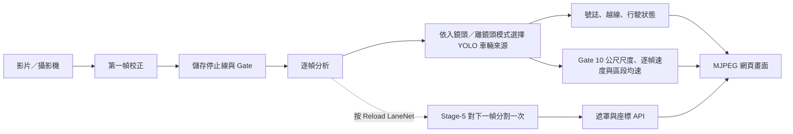
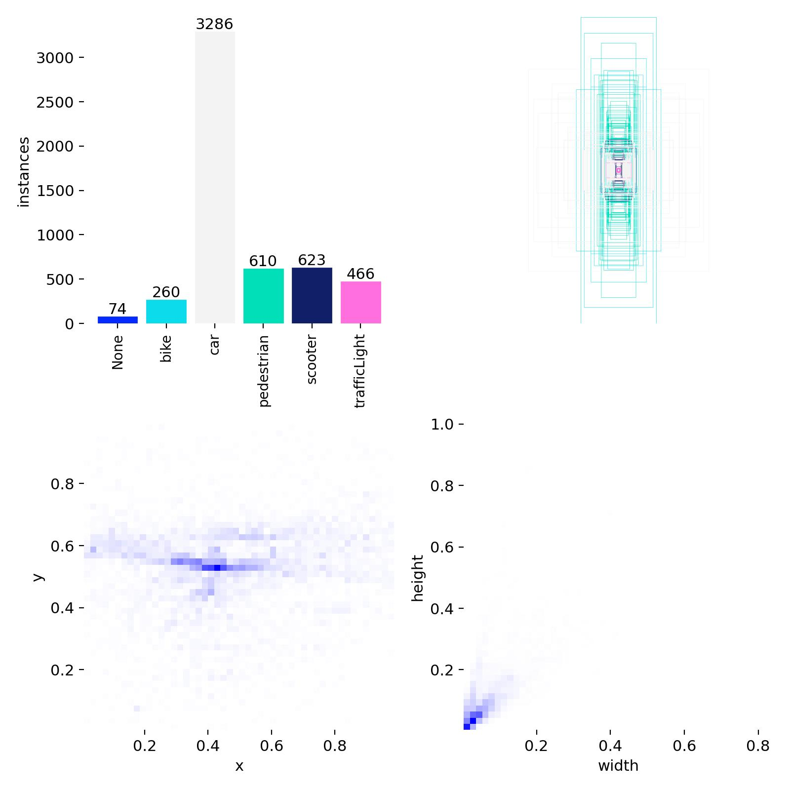
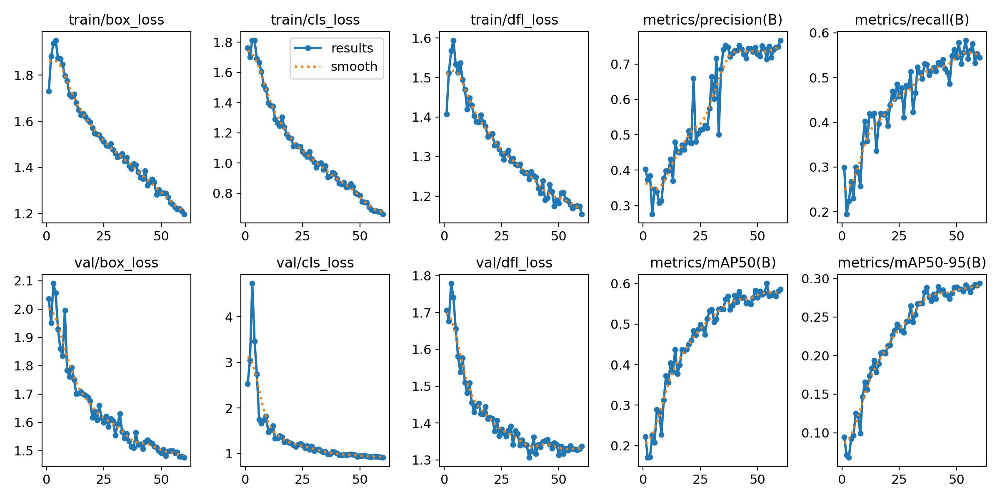
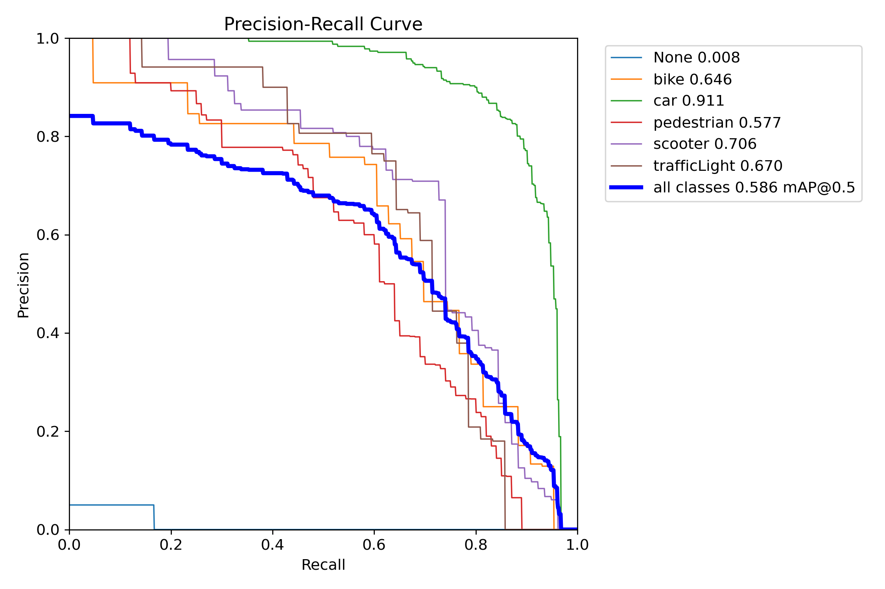
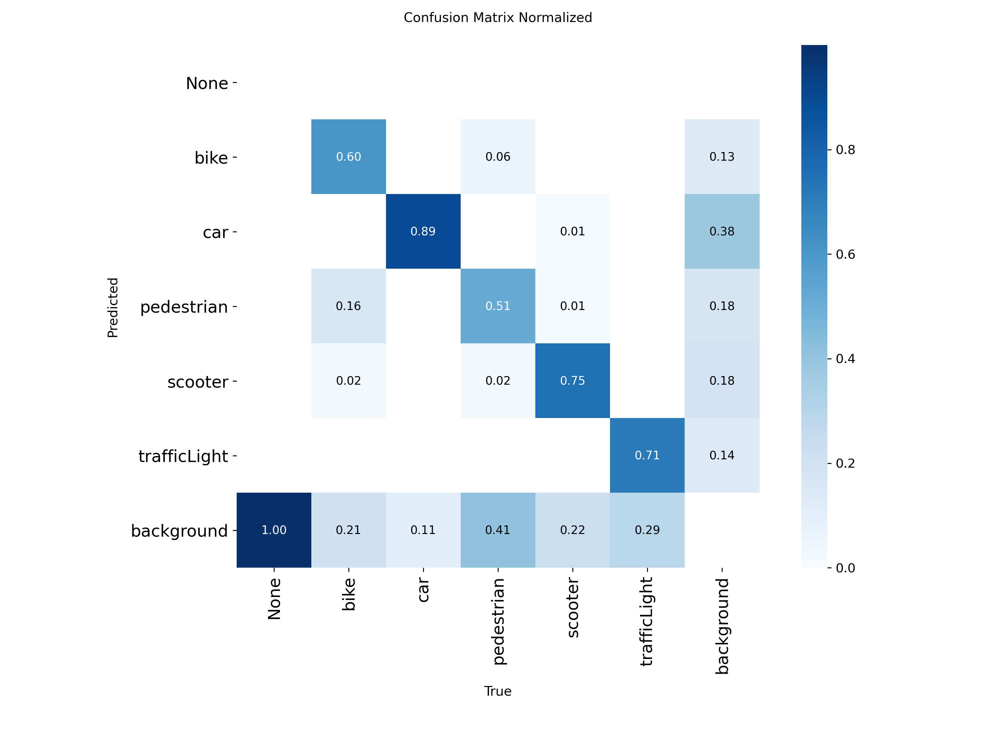
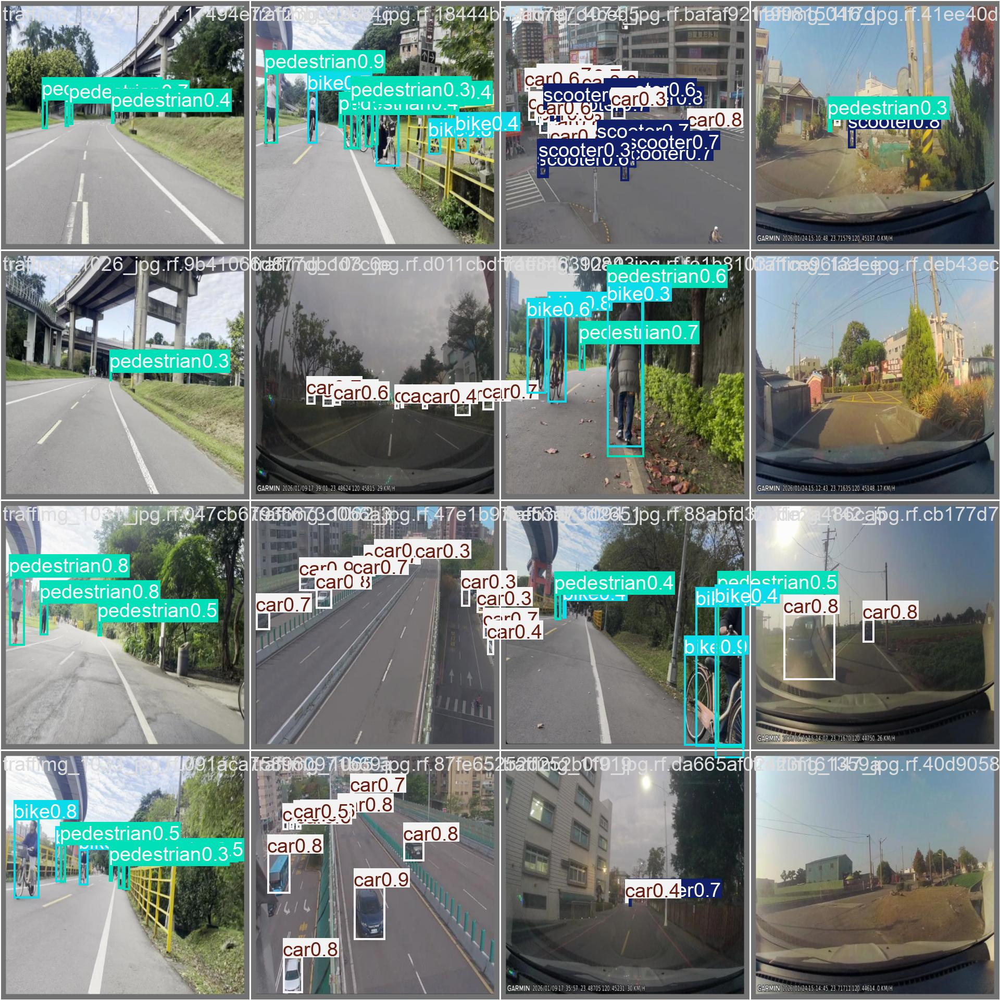

# 交通影像監測系統

本專案是學校專題比賽作品，目標是讓交通影像的違規偵測、車流觀察與場景校正更容易設定，也更容易依使用情境調整。現階段以團隊自行錄製的實際道路影片回測功能；長期目標是讓手機或其他有鏡頭的裝置將即時影像送到雲端伺服器，讓使用者在同一處查看不同地點的交通狀況。

目前主程式以影片、攝影機或 OpenCV 可讀取的影像串流為輸入，分析車輛、交通號誌、停止線越線事件及道路標線。操作員在瀏覽器的第一幀畫面完成校正後，FastAPI 背景工作會逐幀處理影像，並以 MJPEG 串流顯示標註結果。

> **目前功能範圍：** 車輛接地點尚未進入停止線與最後一個 Gate 之間時不顯示速度；位於區間內才顯示黃色逐幀 `EST` 讀數，軌跡尚不足時加上 `(estimate)` 或暫顯示 `EST -- km/h (estimate)`。車輛從停止線或最後一個 Gate 任一端離開區間後，黃色讀數消失，只顯示紅字 `SECTION` 區段測速；不足兩個連續 Gate 穿越點時顯示 `SECTION -- km/h`。兩端使用相同幾何狀態判斷，因此可處理畫面中的雙向車流。正式串流以操作員標示的**相鄰一般 Gate 10 公尺**作為公尺尺度；選配的 `Gate X.4` 將該週期分成 4 公尺與 6 公尺。這是場景設定的距離假設，若實地標線間距不同，時速會有比例誤差。所有數值仍未經真實車速比對，不可視為精確或執法測速。`ILLEGAL` 是依程式的號誌與越線規則產生的提示，應由人員複核。

## 背景、目標與應用

團隊關注臺灣道路車流混雜、路口衝突及人工監看的時間與範圍限制，希望透過影像辨識及可調整的規則，及早發現高風險行為、提高監看效率，並累積可供交通管理參考的車流資訊。系統定位為民間可使用的輔助工具，期望未來與公路局等主管機關合作，比對雙方資料；目前尚未接入公部門資料，也不將模型輸出視為正式裁罰依據。

預想情境包含一般民眾觀察自家車庫前的交通、社區出入口管理，以及政府部門在路口進行初步事件篩查。專題規劃的議題是闖紅燈、違規變道、車流量，以及利用車道標線作為測速基準；各功能的實作狀態如下。

| 功能 | 現階段狀態 |
| --- | --- |
| 紅燈越線提示 | 已依單一號誌顏色與停止線跨越事件實作；仍需人工確認。 |
| 車流量觀察 | 已顯示 `IN`／`OUT` 越線計數與本次處理摘要，尚未提供長期統計。 |
| 車輛行駛／停止狀態 | 已依影像位移分類；不是實際車速。 |
| 行人顯示 | 以預設 YOLO class 0 畫出 `PERSON` 框與信心分數，不參與追蹤、測速、計數或違規判斷。 |
| 道路標線辨識 | 按 Reload LaneNet 後以 Stage-5 對下一幀分割一次，快取遮罩及座標供後續畫面使用。 |
| 違規變道判定 | 規劃以跨越實線、變道時未打方向燈為候選條件；尚未實作事件判定。 |
| 畫面預估測速 | Gate／停止線／邊界提供局部道路幾何；相鄰一般 Gate 固定按 10 公尺換算。車輛位於停止線與末 Gate 之間時以黃字顯示逐幀速度，從任一端離開後只以紅字顯示完整 Gate 區段均速；雙向共用此規則。狀態列提示距離是假設值；尚未與真實車速驗證。 |
| 雲端多鏡頭監看 | 長期目標；目前為單一來源的本機 FastAPI 服務。 |

## 使用流程



1. **準備來源。** 未指定時，程式讀取 `python/main.py` 中 `DEFAULT_VIDEO_NAME` 指定的 `inputVideos/` 影片；也可用 `--source` 指定影片／串流，或用 `--camera` 選擇實體、虛擬攝影機。
2. **校正畫面。** 伺服器先顯示第一幀，此時不執行 YOLO。於網頁上選擇主要偵測是「入鏡頭」或「離鏡頭」，再點兩下設定停止線端點、逐點標出道路左右邊界並按 Enter 完成，最後點選虛線頂端建立至少五條一般 Gate，並設定整條路的車道數。
3. **啟動判斷。** 點選「開始判斷」後，網頁先呼叫 `/save_points` 寫入校正檔，再呼叫 `/start_processing` 啟動背景工作。影片會從指定的起始影格重新讀取。
4. **查看結果。** 網頁顯示車輛 ID、偵測框、`MOVING`／`STOPPED` 狀態、號誌顏色及 `IN`／`OUT` 越線計數。車輛進入停止線與最後一個 Gate 之間後，黃色逐幀速度先顯示 `EST -- km/h (estimate)`，有兩次有效位置後開始顯示數值；至少有四個接地點、軌跡跨越 0.12 秒且速度可與座標抖動區分時移除 `(estimate)`，顯示 0 km/h 則至少觀察 0.4 秒。車輛尚未進入時不顯示速度；從停止線或最後一個 Gate 任一端離開後，只以紅字顯示已完成的連續 Gate 區段均速與起訖 Gate，沒有完整 Gate 對時顯示 `SECTION -- km/h`。下方狀態列會顯示後端實際選定的 YOLO 裝置，以及 Stage-5 在 Reload 時使用的裝置，並提示相鄰一般 Gate 按 10 公尺換算、尚未現地量距。開始判斷後按「Reload LaneNet」才會偵測道路標線並顯示快取結果，座標可由 API 讀取；終端機在處理結束時輸出本次統計。
5. **重新處理或結束。**「重新判斷」會中止目前工作並以網頁上的校正重新開始；「關閉系統」會停止服務。目前只持久儲存校正資料，沒有匯出標註影片、逐筆事件或統計報表。

系統將「物件偵測與追蹤」及「逐像素標線分割」分為兩條處理路徑：前者保留同一車輛的時間資訊，後者提供道路幾何形狀。停止線與 Gate 由人員在當前場景校正，以適應不同鏡頭位置；正規化座標讓網頁縮放時仍能對應回原始影像。多幀投票、越線防抖區與移動狀態遲滯門檻用來降低單幀偵測抖動造成的反覆切換。

## 安裝與執行

本專題固定使用 **Python 3.12.x**，每次執行都須明確指定此版本。另需 `requirements.txt` 中的套件、可讀取的影像來源及模型權重。PyTorch／TorchVision 的安裝方式可能因作業系統與 CUDA 版本而異。

macOS：

```bash
python3.12 --version
python3.12 -m pip install -r requirements.txt
python3.12 python/main.py --source /path/to/video.mp4
```

Windows PowerShell：

```powershell
py -3.12 --version
py -3.12 -m pip install -r requirements.txt
py -3.12 python\main.py --source C:\path\to\video.mp4
```

啟動後開啟 <http://127.0.0.1:8000>。若要使用預設來源，先將 `DEFAULT_VIDEO_NAME` 指定的影片放進 `inputVideos/`，再省略 `--source`。前端「主要偵測」預設為「離鏡頭」：`yolo11x.pt` 只取 person class 0 與 traffic light class 9，Git LFS 管理的 `models/my_model.pt` 取 class 2 car 與 class 4 scooter。切換為「入鏡頭」後，預設 YOLO 使用 person、car、bus、truck、traffic light，`models/my_model.pt` 只提供 scooter；預設 YOLO 的 motorcycle class 3 不使用。兩種模式的 scooter 都只由 `my_model.pt` 判斷，行人都只畫框，不進入車輛機制。`--model` 可改用 YOLO11n／s／m／l／x 或本機相容權重；`--vehicle-model` 指定兩種模式的 scooter，以及離鏡頭模式的 car 權重。道路標線模型預設讀取團隊自行訓練的 `models/road_marking/stage5_roadmark_best.pth`；缺少該模型時可用 `--no-road-markings`。

常用選項（macOS；Windows 將 `python3.12` 改為 `py -3.12`，並依系統調整路徑）：

```bash
# 指定裝置、預設 YOLO 及 car／scooter 模型
python3.12 python/main.py --source /path/to/video.mp4 --device cpu --model /path/to/light-model.pt --vehicle-model /path/to/vehicle-model.pt

# 使用攝影機或 OBS Virtual Camera；索引依電腦而異
python3.12 python/main.py --camera 1 --camera-width 1280 --camera-height 720 --camera-fps 30
python3.12 python/main.py --list-cameras --camera-backend auto

# 調整 Reload LaneNet 時的道路標線推論解析度，或停用道路標線
python3.12 python/main.py --road-marking-max-side 960
python3.12 python/main.py --no-road-markings
```

`--device auto` 依序選擇 CUDA、MPS、CPU；明確指定 CUDA 或 MPS 但當前不可用時會改用 CPU。兩種主要偵測模式每幀都執行預設 YOLO 與團隊車輛 YOLO，因為 scooter 一律由後者判斷；兩個模型使用同一裝置及輸入尺寸：MPS 長邊 640，CUDA／CPU 長邊 512。道路標線模型預設使用長邊 1280；Stage-5 在 YOLO 使用 MPS 時改用 CPU，使用 CUDA 時仍用 CUDA。開始判斷後，網頁狀態列會顯示實際裝置。Windows 攝影機無法讀取時可嘗試 `--camera-backend dshow` 或 `msmf`。其餘選項請在 macOS 執行 `python3.12 python/main.py --help`，或在 Windows 執行 `py -3.12 python\main.py --help`。

Gate 尺度、速度顯示區間、偵測模式、行人繪圖與推論裝置狀態已在 macOS 使用 Python 3.12 執行 `python3.12 -m unittest discover -s tests -v`（75 項通過）與 `python3.12 -m compileall -q python`；前端腳本另以 JavaScriptCore 通過語法檢查。`inputVideos/newVid.mov` 的單一實際影格已在 CPU、512 px 下驗證：「入鏡頭」預設 YOLO 只請求 class 0／2／5／7／9，實際輸出 class 0／2／7／9，`my_model.pt` 只請求並輸出 class 4 scooter；「離鏡頭」先前已驗證預設 YOLO 輸出 class 0／9、`my_model.pt` 輸出 class 2／4。尚未完成整段影片的端到端預估速度、真實速度對照、完整 MJPEG 畫面或 Windows 實測。

`start.command` 與 `start.bat` 現在會確認 Python 3.12.x 並直接呼叫該版本，不搜尋其他執行環境；macOS 腳本遇到已占用的埠號會報錯，不會強制結束其他服務。`start-virtual-camera.bat` 使用 `--device auto`，有 CUDA 時會選 CUDA，否則走 CPU。腳本仍需在各自系統以實際影片或攝影機完成啟動驗證；若要使用 Windows 的 OBS Virtual Camera，先啟動它，再執行 `start-virtual-camera.bat` 或明確指定 `py -3.12 python\main.py --camera 1 --camera-width 1280 --camera-height 720 --camera-fps 30 --device auto`。若只想驗證道路標線模型，macOS 可執行 `python3.12 python/road_marking_demo.py /path/to/image.jpg`，產生單張影像的疊圖與 JSON 座標。

## 停止線與 Gate 校正

在第一幀畫面先點一下**停止線**的 **L** 錨點，移動滑鼠可即時預覽線段，再點一下設定 **R**；停止線應跨越所有要校正的車道。接著從停止線 L 端沿道路逐點點擊左邊界，移動滑鼠時會預覽目前點到滑鼠位置的線段，按 **Enter** 完成；再從 R 端逐點點擊右邊界並按 Enter 完成。邊界可用多點貼合彎道，也可按畫面上的完成按鈕。畫面中的校正線段寬度為 1 px。設定整條路的預設車道數後，逐次點選白色虛線頂端建立 Gate；點選 Gate 清單項目，再拖曳與錨點分開的圓形把手調整角度。前端將經過錨點的直線與兩側邊界求交，交點就是有限 Gate 的兩端。Gate 無法與兩側邊界相交時會顯示警示，不能開始判斷。工具列可暫停繪製、復原、重做及更換 Gate 顏色。

道路車道數固定時，調整「預設車道數」會套用至所有 Gate；它不能單獨推算遠處的畫面寬度，因此仍須標出道路邊界。停止線提供邊界起點與 Gate 初始角度，之後每條 Gate 可自行調整。這只是影像上的人工幾何校正，並未保證 Gate 在真實道路平面與車道方向成 90 度。

前端至少需要五條一般 Gate；在一般 Gate 後可選擇下一條為 `Gate X.4`，表示同週期內的選配位置。前端以 `Gate 1 = 0`、`Gate 1.4 = 4`、`Gate 2 = 10` 填入 `station_m`；後端按 Gate 名稱重新換算並儲存，一般 Gate 每段 10 公尺，選配 Gate 拆成 4／6 公尺。這些公尺數是操作員採用的**現地距離假設**。`lane` 代表車道數而非車道編號。按「開始判斷」時，前端把 Gate 換算成正規化 L/R 線段，連同錨點、角度與道路邊界傳給 `/save_points`；後端寫入 `cord_data/points_data.json` 的版本 3 格式，例如：

停止線兩端的順序會影響跨線側別與 `IN`／`OUT` 的方向；不同影片可在 `python/main.py` 的 `VIDEO_CONFIGS` 設定 `in_transition`。未列入的來源預設以上側到下側為 `IN`，校正時應依畫面中的行進方向確認。

```json
{
  "schema_version": 3,
  "detection_mode": "leaving",
  "video": {"name": "example.mp4", "coordinate_system": "normalized_0_to_1", "width": 1000, "height": 650},
  "lane_count": 2,
  "stop_line": {"line": {"L": {"x": 0.15, "y": 0.60}, "R": {"x": 0.85, "y": 0.60}}},
  "road_boundaries": {
    "L": [{"x": 0.15, "y": 0.60}, {"x": 0.25, "y": 0.10}],
    "R": [{"x": 0.85, "y": 0.60}, {"x": 0.75, "y": 0.10}]
  },
  "gates": [
    {"gate": "Gate 1", "lane": 2, "station_m": 0, "anchor": {"x": 0.50, "y": 0.55}, "angle_deg": 0, "line": {"L": {"x": 0.16, "y": 0.55}, "R": {"x": 0.84, "y": 0.55}}},
    {"gate": "Gate 2", "lane": 2, "station_m": 10, "anchor": {"x": 0.50, "y": 0.45}, "angle_deg": 0, "line": {"L": {"x": 0.18, "y": 0.45}, "R": {"x": 0.82, "y": 0.45}}},
    {"gate": "Gate 3", "lane": 2, "station_m": 20, "anchor": {"x": 0.50, "y": 0.35}, "angle_deg": 0, "line": {"L": {"x": 0.20, "y": 0.35}, "R": {"x": 0.80, "y": 0.35}}},
    {"gate": "Gate 4", "lane": 2, "station_m": 30, "anchor": {"x": 0.50, "y": 0.25}, "angle_deg": 0, "line": {"L": {"x": 0.22, "y": 0.25}, "R": {"x": 0.78, "y": 0.25}}},
    {"gate": "Gate 5", "lane": 2, "station_m": 40, "anchor": {"x": 0.50, "y": 0.15}, "angle_deg": 0, "line": {"L": {"x": 0.24, "y": 0.15}, "R": {"x": 0.76, "y": 0.15}}}
  ]
}
```

後端驗證至少三條 Gate、非零線段、`lane ≥ 1`、座標介於 0～1、`station_m` 遞增，及從 `Gate 1` 起連續編號；選配的 `Gate X.4` 必須緊接 `Gate X`。前端另要求五條一般 Gate。該 JSON 屬執行時校正資料，請勿將不同影像來源的座標直接共用。

「匯出校正 JSON」會另外下載**版本 3** 的 `gate_geometry.json`，儲存主要偵測模式、停止線、原始影像尺寸、車道數、左右邊界，以及各 Gate 的錨點、影像像素角度與 `station_m`；Gate 的 L/R 由前端重新計算，不存於此匯出檔。可用「匯入校正 JSON」載回同尺寸影片的校正，也可手動匯入新版 `points_data.json`；沒有 `detection_mode` 的舊版版本 3 檔案會採「離鏡頭」。仍須人工確認是同一個場景。後端儲存檔同時保留計算出的 L/R，供目前的越線與測速流程使用。網頁不會自動回填既有 Gate。

## 技術原理

### 車輛與交通號誌

「入鏡頭」模式由 `--model` 指定的預設 YOLO 提供 class 2 car、5 bus、7 truck，`models/my_model.pt` 只提供 class 4 scooter；預設 YOLO 的 class 3 motorcycle 會被過濾。「離鏡頭」模式由預設 YOLO 提供 class 0 person、9 traffic light，車輛由 `models/my_model.pt` 的 class 2 car、4 scooter 提供，因此不使用 bus／truck。入鏡頭模式的兩個車輛來源使用不同追蹤 ID 命名空間；若預設 YOLO 車框與自訂 scooter 框高度重疊，保留自訂模型結果，避免同一台車重複進入測速與計數流程。離鏡頭模式保留自訂模型原本的 ByteTrack ID。兩種模式都把 person 畫成紫色 `PERSON` 框與信心分數，不建立本系統的行人追蹤、測速、計數或違規狀態。程式從號誌框中選出「信心分數 × 面積」最高者，將 ROI 轉為 HSV 色彩空間，再以近期結果投票穩定紅綠燈狀態；號誌辨識不依賴車輛追蹤 ID。

### 越線事件與行駛狀態

程式以車輛**接地位置**作為軌跡點：若 YOLO 權重提供實例遮罩，取遮罩靠近車框底部的輪廓點；一般偵測權重則退回框的底部中心。用向量叉積判定其位於停止線哪一側。接地點移動線段確實與**有限的停止線**相交、且跨過 12 像素防抖區時，依方向記為 `IN` 或 `OUT`；垂直與傾斜停止線使用同一幾何判定。同一追蹤狀態下，每個方向只計一次。若當下穩定號誌為 `RED`，車輛被標記為 `ILLEGAL`。目前兩個越線方向都可能觸發紅燈標記。ByteTrack 暫時沒有 ID 的車框會用短期位置關聯供測速，但不參與越線違規與正式車流計數。

行駛狀態先以背景特徵點光流及 RANSAC 估計相鄰影格的局部仿射變換，再扣除攝影機移動對車輛位置的影響，對剩餘的每影格位移做指數平滑。低於 0.5 像素／影格或高於 1.5 像素／影格連續五幀，分別判定 `STOPPED` 或 `MOVING`。這是影像位移分類，**不是實際道路速度**。

### 道路標線

開始判斷後按 **Reload LaneNet**，Stage-5 SegFormer 才會載入並對當前影格進行一次逐像素語意分割；模型隨後釋放，偵測結果在後續影格持續疊圖，直到下一次 Reload。未按 Reload 時不執行 Stage-5 推論；重新判斷會等待上一輪工作執行緒完全結束，並沿用本次服務記憶體中的標線，服務重啟則需重新偵測。標線疊圖的類別色彩遮罩與折線像素座標也會隨結果快取，避免每幀重建。合成 1280×720 影像、20 次繪製的本機測試中，每幀約由 7.5 ms 降至 4.6 ms；這不是完整 YOLO 處理速度。目前輸出 RLMD 類別 1～10、16，包括槽化區、斑馬線、停止線、實線、虛線及導流線。程式透過連通元件擷取輪廓、中心、外接框及中心線；線類擬合為折線。虛線的 `components` 保留各小段，`polylines` 則將可能屬於同一車道的小段串接。API 同時提供原圖像素 `x/y` 與正規化座標 `nx/ny`；`lane_id` 是單次結果內的折線序號，不是跨影格追蹤 ID。

### 違規變道構想（尚未實作）

團隊規劃以道路標線分割辨認實線邊界，再將車輛追蹤軌跡與邊界對照，判定是否跨越實線；另一個候選條件是變道時未打方向燈。後續仍須實作車輛與車道的關聯、方向燈的時序辨識，以及跨線前後的判定時間窗。現有程式只提供標線座標和車輛追蹤資料，尚未將兩者結合成變道事件。

### 僅用影片的預估時速

#### 1. 距離基準與接地點

前端停止線、左右道路邊界與 Gate 定義影像中的道路形狀。程式追蹤車框時，以框底部中央或實例遮罩的底緣作為輪胎接觸路面的近似點。這個點比車框中心更接近道路平面，後續的位置、越線與速度皆以它計算。

正式串流依 Gate 名稱建立公尺里程：相鄰一般 Gate 固定相距 10 公尺；`Gate X.4` 位於 `Gate X` 後 4 公尺，因此到下一條一般 Gate 還有 6 公尺。後端會重新產生 `station_m`，不採用舊 JSON 中不符合規則的距離。停止線到第一條 Gate 沒有已知距離，所以該段只用來界定顯示區域，不加入區段測速。

> **簡單比喻：** Gate 就像田徑場每 10 公尺畫一條計時線。車輛通過兩條線的時間差可換算平均速度；`.4` Gate 像在 10 公尺中再插入一條 4 公尺的中途計時線。距離標錯時，所有時速會跟著等比例偏差。

#### 2. 將斜拍畫面攤平成道路座標

畫面遠處的 10 公尺看起來比近處短，不能直接用「像素／秒」當速度。`python/gate_speed.py` 把每兩條 Gate 的四個端點視為一個道路四邊形，利用透視轉換矩陣 $H$ 映到局部道路座標：橫向位置 $a=0$ 代表左端、$a=1$ 代表右端，縱向 $s$ 是 Gate 的公尺里程。

$$
\begin{bmatrix}\tilde a\\\tilde s\\\tilde w\end{bmatrix}
=H\begin{bmatrix}x\\y\\1\end{bmatrix},\qquad
a=\frac{\tilde a}{\tilde w},\quad
s=\frac{\tilde s}{\tilde w}
$$

車輛接地點 $(x,y)$ 經轉換後得到「位於第幾公尺」及「在道路左、右之間的比例」。相鄰 Gate 各自有局部矩陣；程式在共同 Gate 前後 25% 範圍混合兩段結果，降低跨段時斜率突然改變造成的速度跳動。短段道路在此被近似為平面，坡度與高程並未重建。

> **簡單比喻：** 斜著拍方格紙時，後方格子會縮小；透視轉換像把照片中的方格紙重新拉平。拉平後才可比較車子在不同位置走過多少公尺。

#### 3. 黃字瞬時速度

每個追蹤 ID 會保留最近約 0.5～1 秒的 $(t_i,s_i)$，遠處像素較敏感時使用較長視窗，近處縮短視窗以降低加減速延遲；低 FPS 時最多延長到 3.1 秒，以盡量保留四個有效位置。程式用線性回歸求里程對時間的斜率：

$$
\hat v=\frac{\sum_i(t_i-\bar t)(s_i-\bar s)}{\sum_i(t_i-\bar t)^2},\qquad
v_{km/h}=|\hat v|\times r_{lane}\times3.6
$$

$r_{lane}$ 是彎道車道差修正比例。多幀回歸可分散單一偵測框晃動的影響；四點以上時再排除偏離回歸趨勢的點。程式把接地點向四個方向各移動 2 像素，估計該位置的公尺不確定度，並與軌跡殘差取較大值。有效位移尚無法超過這個誤差時暫顯示 0 km/h；結果再依不確定度平滑並限制單幀變化。非有限值或高於 250 km/h 的新結果不採用。

早期讀數以黃色顯示 `(estimate)`；累積至少四個有效位置、時間跨越 0.12 秒且位移可分辨後才移除標記。0 km/h 至少觀察 0.4 秒。這種穩定處理會增加一些延遲。

> **簡單比喻：** 只看兩張照片，就像按碼錶時手抖一下便可能差很多；系統會連看數張照片，畫出最符合整段軌跡的直線，再把明顯跳掉的一點忽略。

#### 4. 彎道的 Lane Differential

有左右道路邊界時，每個 Gate 區段在兩側各取 25 個路徑點，再依車輛的橫向比例插值出它所在車道的曲線。該曲線長度與道路中央曲線長度之比就是 $r_{lane}$。內彎路徑較短、外彎較長，因此同樣通過兩條 Gate，實際行進距離會略有不同。修正比例只接受 0.75～1.25；超出範圍通常表示邊界或透視映射失真，程式會退回 Gate 基準距離。沒有道路邊界時也直接使用 Gate 距離。

> **簡單比喻：** 田徑場同一個彎道中，外側跑者需要跑得更遠。道路邊界提供類似跑道內、外圈的形狀，讓程式修正這段距離。

#### 5. 紅字區段速度與時間來源

車輛軌跡跨越 Gate 有限線段時，程式在前後兩幀之間插值交點比例 $\lambda$，取得比整數影格更細的穿越時間：

$$
t_{cross}=t_0+\lambda(t_1-t_0),\qquad
v_{section}=\frac{d_{gate}\times r_{lane}}{t_{cross,2}-t_{cross,1}}\times3.6
$$

只有相鄰 Gate、同一車道、穿越間隔至少 0.05 秒且結果不超過 250 km/h 的區段會被接受。每完成一段，程式累積距離與時間，紅字 `SECTION` 使用「累積總距離 ÷ 首尾總時間」，因此比只看一小段穩定。一般 Gate 的區段是 10 公尺，`.4` Gate 將其拆成 4 與 6 公尺。

影片優先讀取單調遞增的 `CAP_PROP_POS_MSEC` 來源時間；來源時間缺失或倒退時改用影格序號除以 FPS。即時攝影機使用單調時鐘。ByteTrack 暫時沒有 ID 的車框會取得 `TEMP` 身分；與正式 ID 在相鄰影格充分匹配時轉移測速狀態，匹配不明確時重新累積。

停止線與最後一個 Gate 的兩條延伸線形成顯示區間，兩個行車方向共用同一套幾何判定：進入前不顯示速度，區間內顯示黃色瞬時速度，從任一端離開後只顯示紅字區段速度；沒有完成一對 Gate 時顯示 `SECTION -- km/h`。追蹤中斷會重設區間狀態。

#### 6. 精度邊界

`GET /api/status` 的 `speed_scale` 回報 `gate_spacing_m: 10` 與 `quality: ASSUMED`，表示 10 公尺是操作員設定的假設值。若真實 Gate 間距為 8 公尺但系統採 10 公尺，結果約會放大為 $10/8=1.25$ 倍。單一固定鏡頭也無法自行恢復真實坡度、鏡頭內參或完整三維道路。

遠處 Gate 在畫面中的間隔較小，1～2 像素誤差可能代表較大的公尺位移；遮擋、鏡頭晃動、低 FPS、追蹤 ID 錯置、Gate 點選誤差及影片時間戳異常也會影響結果。`python/visual_scale.py` 的多車三維尺寸先驗仍是未接入主流程的實驗模組。現有速度尚未用真實車速校驗，不供執法。

## 模型與資料來源

### YOLO 車輛模型訓練紀錄

`models/my_model.pt` 的訓練輸出顯示以預訓練 `yolo11x.pt` 進行偵測微調，共 60 epochs、輸入 640 px、batch 16、seed 0，開啟 deterministic 與 AMP，optimizer 採 Ultralytics `auto`。紀錄的總訓練時間為 6800.72 秒，約 1 小時 53 分 21 秒。完整參數與逐 epoch 數值保存在 [training args](result/yolo/args.yaml) 及 [training metrics CSV](result/yolo/results.csv)。原始設定中的 `/content/data.yaml` 是當時 Colab 路徑，專案目前沒有該資料切分檔，因此還不能只靠本倉庫完整重現訓練。

| 指標 | 此次紀錄的最高值 | Epoch | Epoch 60 結果 |
| --- | ---: | ---: | ---: |
| Precision | 0.7676 | 60 | 0.7676 |
| Recall | 0.5836 | 54 | 0.5451 |
| mAP@0.5 | 0.6009 | 54 | 0.5861 |
| mAP@0.5:0.95 | 0.2935 | 60 | 0.2935 |

訓練標籤圖共記錄 5319 個物件實例。類別分布明顯不平均，car 約為 scooter 的 5.3 倍；這會讓整體指標更受 car 影響。`None` 是資料中實際存在的 class 0 名稱，不是混淆矩陣的 background；其語意不明且 AP@0.5 很低，主程式不使用這個類別。以下 AP@0.5 取自此次輸出的 PR 曲線。

| 自訂模型類別 | 實例數 | AP@0.5 | 主程式用途 |
| --- | ---: | ---: | --- |
| `None`（class 0） | 74 | 0.008 | 不使用；後續資料整理應確認此標籤。 |
| `bike`（class 1） | 260 | 0.646 | 不使用。 |
| `car`（class 2） | 3286 | 0.911 | 離鏡頭模式的汽車。 |
| `pedestrian`（class 3） | 610 | 0.577 | 不使用；行人由預設 YOLO 提供。 |
| `scooter`（class 4） | 623 | 0.706 | 入、離鏡頭模式的機車。 |
| `trafficLight`（class 5） | 466 | 0.670 | 不使用；號誌由預設 YOLO 提供。 |



訓練與驗證 loss 整體下降，mAP 在後段逐漸趨緩；最佳 mAP@0.5 出現在 epoch 54，mAP@0.5:0.95 則在 epoch 60 最高。這些數值來自當時驗證集，不能直接代表新道路、夜間、雨天或遮擋場景的準確率。



<p align="center">
  
  
</p>

正規化混淆矩陣的對角值中，car 為 0.89、scooter 為 0.75；pedestrian 為 0.51，且有 0.41 落到 background。這張圖顯示自訂模型較適合目前程式採用的 car 與 scooter 類別，也顯示其他類別仍有漏檢空間。矩陣比例受驗證資料分布、IoU 與信心門檻影響，不能解讀為道路現場的保證準確率。



### Stage-5 道路標線訓練資料

`stage5/saved_images/` 提供 iter 100～2500、每 100 iter 一組的訓練快照；每組包含 source 與 supervised target 的輸入、標註及預測，共 150 張。這些圖可用來觀察訓練歷程，但資料夾沒有 loss、mIoU、precision、recall、訓練參數或資料切分紀錄，因此目前只能做定性說明。三張固定路況的 checkpoint 對照標示 Stage-5 best 為 iter 2000；README 使用的四張成果已保存於 `result/lanenet/`，不依賴暫存的 `stage5/` 資料夾。

團隊自行訓練 Stage-5 道路標線 checkpoint，並參考下列資料與方法來源。這些連結用途不同：SegFormer 是模型架構與參考實作，不能當作一份獨立的標註資料集。資料集的實際合併比例、標籤映射與訓練配置仍需補齊，才能完整重現訓練。

| 來源 | 在本專題中的參考角色 |
| --- | --- |
| [RLMD](https://github.com/stu9113611/RLMD) | 道路標線語意分割資料集；目前推論類別採其 25 類標籤中的部分類別。 |
| [RMSeg-UDA](https://github.com/stu9113611/RMSeg-UDA) | 惡劣天候道路標線分割的訓練框架與 RLMD-AC 資料集說明。 |
| [Road-Marking-Segmentation](https://github.com/namemzy/Road-Marking-Segmentation) | 另一份道路標線資料集與標註參考。 |
| [SegFormer](https://github.com/NVlabs/SegFormer) | 語意分割模型架構與公開實作。 |
| [RLMD-AC 雲端資料夾](https://drive.google.com/drive/folders/1ZVxIanHEPq5gPjDbKlmZV3K99SsM1NT-?usp=sharing) | 團隊提供的晴天、夜間、雨天資料來源；標註範圍依資料集分割而異。 |

### Stage-5 視覺對照

下圖展示白天、夜間與路口三種影像，並排比較來源影像、原始 28k checkpoint 與 Stage-5 best（圖面標示 iter 2000）的分割疊圖。這是**定性對照**，不代表已取得 mIoU、precision 或 recall 等量化指標。其餘三張詳細遮罩對照見 [result/lanenet 說明](result/lanenet/README.md)。


## 輸出與 API

| 路徑 | 用途 |
| --- | --- |
| `GET /` | 載入 `frontend/main.html` 操作介面。 |
| `GET /first_frame.jpg` | 校正用的第一幀。 |
| `POST /save_points` | 驗證並儲存停止線與 Gate。 |
| `POST /start_processing` | 啟動背景影像分析。 |
| `GET /video_feed` | 標註畫面的 MJPEG 串流。 |
| `GET /api/status` | 執行狀態、主要偵測模式、YOLO／Stage-5 實際裝置、影像尺寸及校正資料。 |
| `GET /api/road_markings` | 最新道路標線結果及模型狀態。 |
| `POST /api/reload_lanenet` | 排程對下一張影格重新載入 Stage-5 並偵測一次。 |
| `POST /api/reset` | 中止並重置本次分析。 |
| `POST /shutdown` | 停止服務。 |

道路標線結果包含 `frame_index`、`inference_ms`、`model_input_size` 與按類別整理的 `objects`。`frame_index` 是最近一次按 Reload 後的偵測影格。網頁顯示畫面與終端機摘要；目前沒有資料庫或報表輸出。

## 專案結構

| 路徑 | 角色 |
| --- | --- |
| `python/main.py` | CLI、FastAPI、分析主迴圈及串流。 |
| `python/Car.py` | 車輛狀態、移動判斷與越線標記。 |
| `python/trafficLight.py` | 號誌 HSV 辨識及多幀投票。 |
| `python/road_marking.py` | SegFormer 推論、疊圖及座標擷取。 |
| `python/gate_speed.py` | Gate 局部透視映射、接地點軌跡估速、異常值過濾與區間穿越校驗。 |
| `python/visual_scale.py` | 多車三維尺寸先驗的實驗模組；目前主程式未啟用。 |
| `python/video_source.py` | 影像來源與攝影機探測。 |
| `frontend/main.html` | 目前服務的網頁介面。 |
| `cord_data/points_data.json` | 操作員校正產生的執行時資料。 |
| `models/my_model.pt` | Git LFS 管理的 car／scooter YOLO 權重。 |
| `models/road_marking/` | Stage-5 checkpoint。 |
| `result/lanenet/` | 精選的 Stage-5 定性視覺與模型對照圖。 |
| `result/yolo/` | 自訂 YOLO 的訓練參數、逐 epoch 指標、資料分布、曲線、混淆矩陣及驗證預測。 |
| `tests/` | 影像來源、道路標線座標、Reload LaneNet、Gate 校正與測速的單元測試。 |

`frontend/main2.html` 與 `frontend/toweb.py` 是其他／舊版介面及串流輔助程式，目前首頁不使用。`yaml/my_track.yaml` 是追蹤器設定範例，主程式目前指定 Ultralytics 的 `bytetrack.yaml`。

## 驗證與限制

macOS：

```bash
python3.12 -m compileall -q python
python3.12 -m unittest discover -s tests -v
```

Windows PowerShell：

```powershell
py -3.12 -m compileall -q python
py -3.12 -m unittest discover -s tests -v
```

現有測試涵蓋道路標線座標、Reload LaneNet 及影像來源輔助函式；團隊也以自行錄製的多種實際路況影片，在 Windows、macOS 的筆電與桌機上進行回測。自訂 YOLO 的訓練曲線、驗證指標與代表性圖片已移到 `result/yolo/`，Stage-5 的四張精選結果圖位於 `result/lanenet/`。YOLO 尚缺原始 `data.yaml` 與可重建的資料切分；Stage-5 尚缺量化指標及完整訓練設定，所以現有圖表不能推論未見場景或道路現場的保證準確率。

完整流程需要模型、影片或攝影機及可用的運算環境。單一號誌選取、追蹤 ID 中斷、遮蔽、鏡頭晃動與透視變化都可能影響結果。現階段沒有現場執法或物理測速驗證，也沒有逐筆事件持久化。

多人協作時，每次完成修改都要依實際程式狀態同步檢查並更新本文件與 `AGENTS.md`；目前功能、操作命令與未完成目標應在兩份文件中保持一致。
