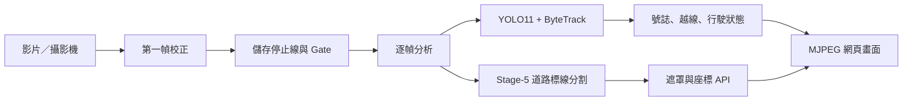
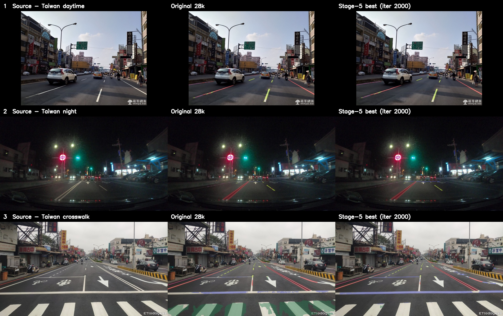

# 交通影像監測系統

本專案是學校專題比賽作品，目標是讓交通影像的違規偵測、車流觀察與場景校正更容易設定，也更容易依使用情境調整。現階段以團隊自行錄製的實際道路影片回測功能；長期目標是讓手機或其他有鏡頭的裝置將即時影像送到雲端伺服器，讓使用者在同一處查看不同地點的交通狀況。

目前主程式以影片、攝影機或 OpenCV 可讀取的影像串流為輸入，分析車輛、交通號誌、停止線越線事件及道路標線。操作員在瀏覽器的第一幀畫面完成校正後，FastAPI 背景工作會逐幀處理影像，並以 MJPEG 串流顯示標註結果。

> **目前功能範圍：** Gate 的線段、車道數與 `station_m` 已可校正並儲存，但主程式尚未用 Gate 計算車速。`ILLEGAL` 是依程式的號誌與越線規則產生的提示，應由人員複核。

## 背景、目標與應用

團隊關注臺灣道路車流混雜、路口衝突及人工監看的時間與範圍限制，希望透過影像辨識及可調整的規則，及早發現高風險行為、提高監看效率，並累積可供交通管理參考的車流資訊。系統定位為民間可使用的輔助工具，期望未來與公路局等主管機關合作，比對雙方資料；目前尚未接入公部門資料，也不將模型輸出視為正式裁罰依據。

預想情境包含一般民眾觀察自家車庫前的交通、社區出入口管理，以及政府部門在路口進行初步事件篩查。專題規劃的議題是闖紅燈、違規變道、車流量，以及利用車道標線作為測速基準；各功能的實作狀態如下。

| 功能 | 現階段狀態 |
| --- | --- |
| 紅燈越線提示 | 已依單一號誌顏色與停止線跨越事件實作；仍需人工確認。 |
| 車流量觀察 | 已顯示 `IN`／`OUT` 越線計數與本次處理摘要，尚未提供長期統計。 |
| 車輛行駛／停止狀態 | 已依影像位移分類；不是實際車速。 |
| 道路標線辨識 | 已整合 Stage-5 分割遮罩及座標 API。 |
| 違規變道判定 | 規劃以跨越實線、變道時未打方向燈為候選條件；尚未實作事件判定。 |
| Gate 測速 | 已有人工校正資料結構；距離映射與通過時間計算尚未接入主流程。 |
| 雲端多鏡頭監看 | 長期目標；目前為單一來源的本機 FastAPI 服務。 |

## 使用流程



1. **準備來源。** 未指定時，程式讀取 `inputVideos/IMG_6898.MOV`；也可用 `--source` 指定影片／串流，或用 `--camera` 選擇實體、虛擬攝影機。
2. **校正畫面。** 伺服器先顯示第一幀，此時不執行 YOLO。於網頁上先畫停止線，再依序畫至少三條 Gate，設定每條 Gate 的車道數。
3. **啟動判斷。** 點選「開始判斷」後，網頁先呼叫 `/save_points` 寫入校正檔，再呼叫 `/start_processing` 啟動背景工作。影片會從指定的起始影格重新讀取。
4. **查看結果。** 網頁顯示車輛 ID、偵測框、`MOVING`／`STOPPED` 狀態、號誌顏色、`IN`／`OUT` 越線計數及道路標線。終端機在處理結束時輸出本次統計；道路標線座標可由 API 讀取。
5. **重新處理或結束。**「重新判斷」會中止目前工作並以網頁上的校正重新開始；「關閉系統」會停止服務。目前只持久儲存校正資料，沒有匯出標註影片、逐筆事件或統計報表。

系統將「物件偵測與追蹤」及「逐像素標線分割」分為兩條處理路徑：前者保留同一車輛的時間資訊，後者提供道路幾何形狀。停止線與 Gate 由人員在當前場景校正，以適應不同鏡頭位置；正規化座標讓網頁縮放時仍能對應回原始影像。多幀投票、越線防抖區與移動狀態遲滯門檻用來降低單幀偵測抖動造成的反覆切換。

## 安裝與執行

需要 Python、`requirements.txt` 中的套件、可讀取的影像來源及模型權重。PyTorch／TorchVision 的安裝方式可能因作業系統與 CUDA 版本而異。

macOS／Linux：

```bash
python3 -m venv .venv
source .venv/bin/activate
python -m pip install -r requirements.txt
python python/main.py --source /path/to/video.mp4
```

Windows PowerShell：

```powershell
py -m venv .venv
.\.venv\Scripts\python.exe -m pip install -r requirements.txt
.\.venv\Scripts\python.exe python\main.py --source C:\path\to\video.mp4
```

啟動後開啟 <http://127.0.0.1:8000>。若要使用預設來源，先將 `IMG_6898.MOV` 放進 `inputVideos/`，再省略 `--source`。專題會依測試需求使用 YOLO11s 或 YOLO11x；目前程式預設 `yolo11x.pt`，第一次使用該官方模型名稱時，Ultralytics 會嘗試下載。要改用 11s 或其他權重，先備妥本機 `.pt` 檔，再以 `--model` 指定。道路標線模型預設讀取團隊自行訓練的 `models/road_marking/stage5_roadmark_best.pth`；缺少該模型時可用 `--no-road-markings`。

常用選項：

```bash
# 指定裝置及自訂 YOLO 權重
python python/main.py --source /path/to/video.mp4 --device cpu --model /path/to/model.pt

# 使用攝影機或 OBS Virtual Camera；索引依電腦而異
python python/main.py --camera 1 --camera-width 1280 --camera-height 720 --camera-fps 30
python python/main.py --list-cameras --camera-backend auto

# 降低道路標線推論頻率／解析度，或停用道路標線
python python/main.py --road-marking-every 3 --road-marking-max-side 960
python python/main.py --no-road-markings
```

`--device auto` 依序選擇 MPS、CUDA、CPU。YOLO 輸入長邊目前於 MPS 使用 960，CUDA／CPU 使用 640；道路標線模型預設使用長邊 1280。Windows 攝影機無法讀取時可嘗試 `--camera-backend dshow` 或 `msmf`。`start.bat` 會優先尋找專案內虛擬環境；`start.command` 是 macOS 啟動器。其餘選項請執行 `python python/main.py --help`。

Windows 的 `start-virtual-camera.bat` 會以攝影機索引 1、1280×720、30 FPS 與 CUDA 啟動；使用前請先開啟 OBS Virtual Camera，並確認目前電腦支援該裝置及索引。若只想驗證道路標線模型，可執行 `python python/road_marking_demo.py /path/to/image.jpg`，產生單張影像的疊圖與 JSON 座標。

## 停止線與 Gate 校正

在第一幀畫面按住滑鼠左鍵拖曳；按下的位置為 **L**，放開的位置為 **R**。第一條是停止線，之後依序為 Gate 1、Gate 2、Gate 3……。畫完停止線後可調整「預設車道數」，新 Gate 會使用當下的數值，也可在 Gate 清單修改個別車道數。工具列提供暫停繪製、復原、重做與變更預覽顏色。

前端自動設定 `station_m = Gate 序號 × 10`，目前沒有編輯實際里程的欄位，也不會從道路標線自動推算 Gate 距離。`lane` 在現行資料格式代表**車道數**，並非車道編號；`station_m` 尚未供主程式測速。至少三條 Gate 才能開始。按下「開始判斷」時，資料會以原始畫面寬高的 **0～1 正規化座標** 寫入 `cord_data/points_data.json`：

停止線兩端的順序會影響跨線側別與 `IN`／`OUT` 的方向；不同影片可在 `python/main.py` 的 `VIDEO_CONFIGS` 設定 `in_transition`。未列入的來源預設以上側到下側為 `IN`，校正時應依畫面中的行進方向確認。

```json
{
  "schema_version": 2,
  "video": {"name": "example.mp4", "coordinate_system": "normalized_0_to_1"},
  "stop_line": {"line": {"L": {"x": 0.15, "y": 0.60}, "R": {"x": 0.85, "y": 0.60}}},
  "gates": [
    {"gate": "Gate 1", "lane": 2, "station_m": 10, "line": {"L": {"x": 0.15, "y": 0.65}, "R": {"x": 0.85, "y": 0.65}}},
    {"gate": "Gate 2", "lane": 2, "station_m": 20, "line": {"L": {"x": 0.15, "y": 0.70}, "R": {"x": 0.85, "y": 0.70}}},
    {"gate": "Gate 3", "lane": 2, "station_m": 30, "line": {"L": {"x": 0.15, "y": 0.75}, "R": {"x": 0.85, "y": 0.75}}}
  ]
}
```

後端驗證至少三條 Gate、`lane ≥ 1`、座標介於 0～1，且 `station_m` 依順序遞增。該 JSON 屬執行時校正資料，請勿將不同影像來源的座標直接共用。後端會讀取已存的停止線；目前網頁**不會自動回填既有 Gate**，重新開啟頁面仍需完成畫線流程。

## 技術原理

### 車輛與交通號誌

YOLO11 偵測 COCO 類別中的汽車、機車、公車、卡車與交通號誌，Ultralytics 的 ByteTrack 為車輛維持追蹤 ID。程式從號誌框中選出「信心分數 × 面積」最高者，將其 ROI 轉為 HSV 色彩空間，以紅、綠像素比例判斷顏色，再以近期有效結果投票取得穩定狀態。無法辨識的一幀不會立即清除前一個狀態。目前沒有黃燈判斷，也沒有將號誌分別對應到不同車道。

### 越線事件與行駛狀態

程式取車輛偵測框的**底部中心點**作為位置，用向量叉積判定其位於停止線哪一側。位置穿越線段且超過 12 像素防抖區時，依方向記為 `IN` 或 `OUT`；同一追蹤狀態下，每個方向只計一次。若當下穩定號誌為 `RED`，車輛被標記為 `ILLEGAL`。目前兩個越線方向都可能觸發紅燈標記。

行駛狀態先以背景特徵點光流及 RANSAC 估計相鄰影格的局部仿射變換，再扣除攝影機移動對車輛位置的影響，對剩餘的每影格位移做指數平滑。低於 0.5 像素／影格或高於 1.5 像素／影格連續五幀，分別判定 `STOPPED` 或 `MOVING`。這是影像位移分類，**不是實際道路速度**。

### 道路標線

Stage-5 SegFormer 對每幀進行逐像素語意分割，再將結果縮放回原圖。目前輸出 RLMD 類別 1～10、16，包括槽化區、斑馬線、停止線、實線、虛線及導流線。程式透過連通元件擷取輪廓、中心、外接框及中心線；線類擬合為折線。虛線的 `components` 保留各小段，`polylines` 則將可能屬於同一車道的小段串接。API 同時提供原圖像素 `x/y` 與正規化座標 `nx/ny`；`lane_id` 是單次結果內的折線序號，不是跨影格追蹤 ID。

### 違規變道構想（尚未實作）

團隊規劃以道路標線分割辨認實線邊界，再將車輛追蹤軌跡與邊界對照，判定是否跨越實線；另一個候選條件是變道時未打方向燈。後續仍須實作車輛與車道的關聯、方向燈的時序辨識，以及跨線前後的判定時間窗。現有程式只提供標線座標和車輛追蹤資料，尚未將兩者結合成變道事件。

### 測速構想（尚未實作）

團隊計畫讓操作員標示白色虛線及相鄰週期的起訖點，將道路標線當作距離基準。[《道路交通標誌標線號誌設置規則》第 182 條](https://www.mvdis.gov.tw/webMvdisLaw/LawArticle.aspx?LawID=A0011025)對一般車道線規定：白虛線線段長 4 公尺、間距 6 公尺，因此一個完整週期可作為 **10 公尺的設計參考**。實際測速前仍須確認該路段標線類型、現地尺寸，以及影像中 Gate 與標線的對應關係；現有前端自動填入的 10、20、30 並非已量測距離。

規劃中的方法是以已知路面距離、透視幾何及消失點建立影像座標與道路位置的對應，再記錄同一車輛通過兩個 Gate 的時間差，以 `速度 = 道路行進距離 ÷ 通過時間差` 估算車速。彎道路段的內、外車道行進距離不同，須分車道校正行進路徑及弧長；僅憑畫面中兩條 Gate 的夾角不足以直接得到實際距離。這些幾何校正、時間戳處理與誤差驗證均尚未接入程式。

## 模型與資料來源

團隊自行訓練 Stage-5 道路標線 checkpoint，並提供下列資料與方法來源。這些連結的用途不同：SegFormer 是模型架構與參考實作，不能當作一份獨立的標註資料集。資料集的實際合併比例、標籤映射與訓練配置仍需由團隊補上，才能完整重現訓練。

| 來源 | 在本專題中的參考角色 |
| --- | --- |
| [RLMD](https://github.com/stu9113611/RLMD) | 道路標線語意分割資料集；目前推論類別採其 25 類標籤中的部分類別。 |
| [RMSeg-UDA](https://github.com/stu9113611/RMSeg-UDA) | 惡劣天候道路標線分割的訓練框架與 RLMD-AC 資料集說明。 |
| [Road-Marking-Segmentation](https://github.com/namemzy/Road-Marking-Segmentation) | 另一份道路標線資料集與標註參考。 |
| [SegFormer](https://github.com/NVlabs/SegFormer) | 語意分割模型架構與公開實作。 |
| [RLMD-AC 雲端資料夾](https://drive.google.com/drive/folders/1ZVxIanHEPq5gPjDbKlmZV3K99SsM1NT-?usp=sharing) | 團隊提供的晴天、夜間、雨天資料來源；標註範圍依資料集分割而異。 |

### Stage-5 視覺對照

下圖展示白天、夜間與路口三種影像，並排比較來源影像、原始 28k checkpoint 與 Stage-5 best（圖面標示 iter 2000）的分割疊圖。這是**定性對照**，不代表已取得 mIoU、precision 或 recall 等量化指標。其餘三張詳細遮罩對照見 [result/lanenet 說明](result/lanenet/README.md)。



## 輸出與 API

| 路徑 | 用途 |
| --- | --- |
| `GET /` | 載入 `frontend/main.html` 操作介面。 |
| `GET /first_frame.jpg` | 校正用的第一幀。 |
| `POST /save_points` | 驗證並儲存停止線與 Gate。 |
| `POST /start_processing` | 啟動背景影像分析。 |
| `GET /video_feed` | 標註畫面的 MJPEG 串流。 |
| `GET /api/status` | 執行狀態、影像尺寸及校正資料。 |
| `GET /api/road_markings` | 最新道路標線結果及模型狀態。 |
| `POST /api/reset` | 中止並重置本次分析。 |
| `POST /shutdown` | 停止服務。 |

道路標線結果包含 `frame_index`、`inference_ms`、`model_input_size` 與按類別整理的 `objects`。若設定 `--road-marking-every N`，未推論的影格會沿用上一筆遮罩，應用 `frame_index` 判讀結果時間。網頁顯示畫面與終端機摘要；目前沒有資料庫或報表輸出。

## 專案結構

| 路徑 | 角色 |
| --- | --- |
| `python/main.py` | CLI、FastAPI、分析主迴圈及串流。 |
| `python/Car.py` | 車輛狀態、移動判斷與越線標記。 |
| `python/trafficLight.py` | 號誌 HSV 辨識及多幀投票。 |
| `python/road_marking.py` | SegFormer 推論、疊圖及座標擷取。 |
| `python/video_source.py` | 影像來源與攝影機探測。 |
| `frontend/main.html` | 目前服務的網頁介面。 |
| `cord_data/points_data.json` | 操作員校正產生的執行時資料。 |
| `models/road_marking/` | Stage-5 checkpoint。 |
| `result/lanenet/` | 精選的 Stage-5 定性視覺與模型對照圖。 |
| `result/yolo/` | 預留 YOLO 驗證成果目錄。 |
| `tests/` | 影像來源與道路標線座標的單元測試。 |

`frontend/main2.html` 與 `frontend/toweb.py` 是其他／舊版介面及串流輔助程式，目前首頁不使用。`yaml/my_track.yaml` 是追蹤器設定範例，主程式目前指定 Ultralytics 的 `bytetrack.yaml`。

## 驗證與限制

```bash
python -m py_compile python/*.py
python -m unittest discover -s tests -v
```

現有測試涵蓋道路標線座標處理與影像來源輔助函式；團隊也以自行錄製的多種實際路況影片，在 Windows、macOS 的筆電與桌機上進行回測。Stage-5 的四張精選結果圖已放在 `result/lanenet/`，但目前沒有可重現的評估設定或量化指標，因此不能由視覺對照推論偵測準確率。

完整流程需要模型、影片或攝影機及可用的運算環境。單一號誌選取、追蹤 ID 中斷、遮蔽、鏡頭晃動與透視變化都可能影響結果。現階段沒有現場執法或物理測速驗證，也沒有逐筆事件持久化。
